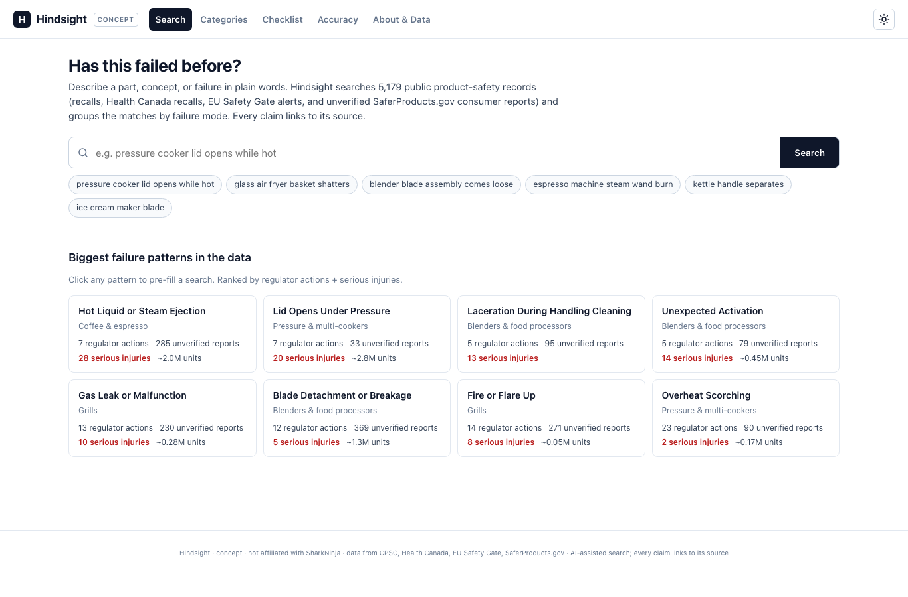
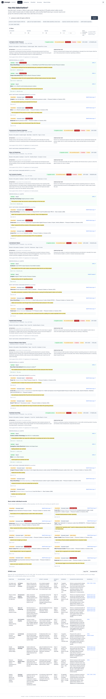
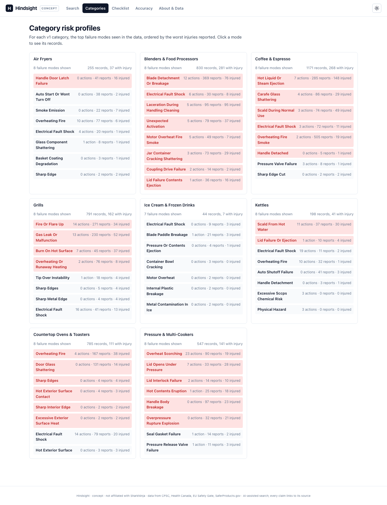

# Hindsight

**Type a product concept or part. Get every similar real-world failure across all
brands, grouped by failure mode, as DFMEA-ready rows with a quoted source on every
claim.**

Live: <https://hindsight.mayank-goel.com>



## What this is

A concept DFMEA search tool for small-kitchen-appliance NPD. It indexes 5,179
public product-safety records — CPSC and Health Canada recalls, EU Safety Gate
alerts, and (clearly labeled) SaferProducts.gov consumer reports — into 122
category × failure-mode patterns. When an engineer types "pressure cooker lid
opens while hot", Hindsight returns the full pattern it matches (regulator-action
count, injury profile, year span, units affected, top brands), the verified
recalls that make the pattern, and a few of the best-matching unverified
consumer reports, plus a DFMEA-ready table copied to Excel or CSV.

Not affiliated with SharkNinja.



## How it works

```
         ┌──────────── pipeline (scripts/) ────────────┐
         │ 1. normalize   raw/ → records.json          │   One record shape across sources.
         │ 2. extract     Gemini → component/mode/     │   Cached per record-hash; quotes
         │                cause/effect/quote           │   verified in CODE, not AI.
         │ 3. embed       Gemini embed-2 @ 256 dims    │   int8-quantized → vectors.bin.
         │ 4. patterns    cat × failure_mode groups    │   Numbers computed in code; AI
         │                (mitigation + verif. test)   │   text number-checked.
         │ 5. evaluate    60 labeled recs + 15 queries │   Published in-app.
         └──────────────────────────────────────────────┘
                                   │
                                   ▼
┌──────────── app (public/) ────────────┐        ┌───── api (api/) ─────┐
│ static HTML + 1 JS module + Tailwind-  │ POST q │ /api/search          │
│ free CSS. Loads patterns.json + a tiny │───────▶│ embeds query (same   │
│ meta-index at boot; full meta.json is  │        │ Gemini model+dims),  │
│ lazy-loaded on first search. Pattern   │ ids+   │ dot-product over     │
│ aggregation, grouping, DFMEA export    │ scores │ vectors.bin, returns │
│ and copy/download all run client-side. │◀───────│ top-200 ids+scores.  │
└────────────────────────────────────────┘        │ Rate-limited via     │
                                                  │ Upstash (fail-closed │
                                                  │ in production).      │
                                                  └──────────────────────┘
```

- **Pattern-aware ranking.** The top-scoring record in each pattern dominates;
  a mild log(count) breadth bonus + worst-injury tie-break; an explicit category
  boost when the query names a category ("air fryer", "pressure cooker", "kettle"
  etc.) so a glass-basket search doesn't surface oven-door-glass instead.
- **Verified recalls get prominence.** Each pattern card shows CPSC / HC / EU
  Safety Gate recalls first (brand, product, date, units, injury, quote, link),
  then the best-matching unverified consumer reports in a separate section.
- **Canonicalization in the pipeline.** Brand variants
  (`Crock-Pot`/`CROCK POT`/`Sunbeam d/b/a Jarden …`) collapse to one display
  name with the manufacturer in parens; `other:*` failure modes merge their
  near-duplicates (`glass lid shattered` / `shattered glass lid` / … → `glass
  lid shattering`).



## Data sources + licences

| Source | What | Licence |
| --- | --- | --- |
| [CPSC Recalls API](https://www.cpsc.gov/Recalls) | US regulator recalls | US Government work — public domain |
| [Health Canada Recalls](https://recalls-rappels.canada.ca/en/) | Canadian regulator recalls | Open Government Licence — Canada |
| [EU Safety Gate](https://ec.europa.eu/safety-gate-alerts/) | EU alerts | © European Union, reuse allowed with attribution |
| [SaferProducts.gov](https://www.saferproducts.gov/) | US consumer reports (**unverified**) | US Government work — public domain |

Every record on the site links back to its source so you can read the original.
Hindsight stores and ships only the normalized, extracted fields plus one
verifying quote per record.

## Accuracy (today's numbers, from `public/data/eval.json`)

| Metric | Score | What it means |
| --- | --- | --- |
| Failure-mode accuracy | **78.3%** | On 60 hand-labeled records, how often the AI picks the right failure-mode bucket. |
| Hazard-type accuracy | **81.7%** | How often it picks the right hazard (burn / fire / laceration / shock / …). |
| Quote-support rate | **99.9%** | How often the quote is actually in the source text (code-verified, exact or near). |
| Relevance hit@10 | **86.7%** | For 15 engineer queries, how often at least one of the top-10 is in the right category + failure mode. |
| Strict hit@10 | **40.0%** | Conservative lower bound: how often a specific labeled record id lands in the top 10 (many near-identical valid matches outrank the chosen label). |

## Limitations — read these

- **"Unverified consumer report" means unverified.** The SaferProducts.gov
  reports are published after a short review but not independently investigated.
  Hindsight shows them because they are the largest signal of real-world
  consumer use. It labels them "unverified" on every surface they appear in and
  never counts them as recalls.
- **Severity hint ≠ severity score.** The severity column in the DFMEA export
  is a hint derived from the injury profile of the matching records. Replace
  with a verified severity rating in your own DFMEA.
- **Standards are hints, not conformance.** Phrases like "Check against
  IEC/UL 60335-2-15" are suggestions of which standard to review. Hindsight
  never claims a design "complies".
- **AI retrieval is probabilistic.** Hindsight returns "No matching record"
  rather than a weak match below a similarity threshold, but you should still
  skim the quotes to make sure the match is real.
- **Scope v1 is only Ninja NPD categories.** Pressure & multi-cookers, air
  fryers, blenders & food processors, ice cream / frozen drink, coffee &
  espresso, kettles, countertop ovens & toasters, grills. Nothing else.
- **One record = one failure.** The extractor picks the single most important
  failure mode per record. Multi-failure records are a known blind spot.

## Roadmap — "bring your own data"

The record schema (hazard text, failure_mode, cause, effect, verifying quote,
source) is the same shape as a DFMEA row. The pipeline accepts your own FMEAs,
DVT/EMC results, field returns, and lessons-learned — once that private data
lands in `data/raw/`, every search covers your history too. Public data makes
the demo useful on day one; private data is what makes the tool indispensable.

## Run locally

```bash
# One-time: data pipeline (needs GEMINI_API_KEY)
npm run pipeline

# Dev server (no Vercel login required)
node --env-file=../Portfolio/.env.local scripts/dev-server.mjs
# then open http://localhost:3000

# Tests
npm test
```

The pipeline's four Gemini-touching steps (`extract`, `embed`, `patterns`,
`evaluate`) all cache per record-hash, so dropped connections resume for free.
`extract` and `embed` are the only steps that spend meaningful money; patterns
and evaluate together are a few cents.

## Repo map

| Path | What |
| --- | --- |
| `public/` | The static site (deployed as-is). |
| `public/data/` | `vectors.bin`, `meta.json`, `meta-index.json`, `patterns.json`, `eval.json`. |
| `public/lib/` | Pure helpers (DFMEA export, search ranking) shared by the UI and tests. |
| `api/` | Vercel Node functions. Only `/api/search` ships. |
| `api/_lib/` | Shared server code (underscore prefix = not deployed as a route). |
| `scripts/` | Pipeline + fetchers + the Vercel-free dev server. |
| `scripts/lib/` | `canon.mjs` (brand + failure-mode canonicalization), `taxonomy.mjs`, `gemini.mjs`, etc. |
| `test/` | `node --test` unit + handler tests (mocked fetch). `npm test`. |

## Weekly data refresh

A GitHub Action (`.github/workflows/weekly-refresh.yml`) re-runs the pipeline
every Monday at 10:00 UTC, commits updated `public/data/*` back to `main`, and
publishes a new build. Caches (per-record extraction + embedding) and raw-source
snapshots are persisted on an orphan `data-cache` branch (force-pushed each
run), so a weekly refresh only pays for genuinely new records. A hard cost
guard aborts the run if more than ~600 records would need a new extract call.
Source failures are tolerated — if a feed is unreachable, the previous
snapshot is reused and the run summary flags the stale source.

Scheduled refreshes are time-limited to the three Mondays Nov 2, Nov 9 and
Nov 16, 2026. After 2026-11-17 UTC the workflow's first step short-circuits
scheduled runs; manual `workflow_dispatch` runs still work.

## Not affiliated

Hindsight is a concept built by [Mayank Goel](https://mayank-goel.com) as a
job-search demonstration. Not affiliated with SharkNinja, Ninja, CPSC, Health
Canada or the European Commission. All data is open government data; the brand
names and recall details belong to their respective companies and regulators.
